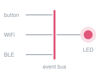
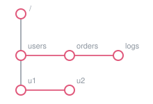

<picture>
  <source media="(prefers-color-scheme: dark)" srcset="assets/header-dark.svg">
  
</picture>

At work I build full-stack web and mobile apps in **TypeScript** (React, Next.js, Node, Express) and **Flutter** (Riverpod, Firebase). On my own time I go lower down the stack: a database server in C and firmware for an ESP32. I also read a lot, which is why one of the apps below catalogues my bookshelves for me.

[LinkedIn](https://www.linkedin.com/in/yash-hemnani-yh25) · [All repositories](https://github.com/yash25hemnani?tab=repositories)

 

## What I've been building

### [A Little Tap](https://github.com/yash25hemnani/a_little_tap)

A couples app. Tap the heart and your partner's phone buzzes with a pattern that means something: two heartbeats for *Miss you*, a warm swell for *Here for you*. You can draw your own patterns in a waveform editor, see when your partner is around, and look back on every tap you've shared. Push notifications go out through a [Cloudflare Worker](https://github.com/yash25hemnani/little-tap-cloudflare-worker).

Flutter, Riverpod, Firebase, Cloudflare Workers, TypeScript

 

### [Shelf Snap](https://github.com/yash25hemnani/shelf-snap)

Point your camera at a bookshelf and get a searchable library. On-device OCR reads the spines, an LLM turns the fragments back into real titles and authors, and Google Books confirms the matches. It also scans barcodes live, and you can share a library with friends by inviting their username. The AI step runs through a small [Express API](https://github.com/yash25hemnani/shelf-snap-wrapper) in front of Groq.

Flutter, Riverpod, Firebase, ML Kit, Express, TypeScript

 

### [Y-Bot](https://github.com/yash25hemnani/y-bot-esp32)

ESP32 firmware that responds to a physical button and to remote commands over WiFi or BLE. Every input goes onto one event bus (button presses straight from the interrupt handler), which routes it to modules like the onboard LED. It has a [Flutter app](https://github.com/yash25hemnani/y-bot-app) and an [admin panel](https://github.com/yash25hemnani/y-bot-admin-panel).

ESP32, C++, PlatformIO, BLE

 

### [Memora DB](https://github.com/yash25hemnani/memora-db)

A TCP database server written from scratch in C. Each client gets its own forked process. Data lives in a left-child/right-sibling tree of paths, a hand-rolled hash table keeps lookups fast, and every database is saved to a flat file.

C, Make

 

## What I work with

| | |
|---|---|
| **Languages** | TypeScript, JavaScript, Dart, Python, C++, C |
| **Web & backend** | React, Next.js, Node.js, Express, TanStack Query, Zod, Django, FastAPI |
| **Mobile** | Flutter, Riverpod, Firebase |
| **Embedded** | ESP32, PlatformIO |
